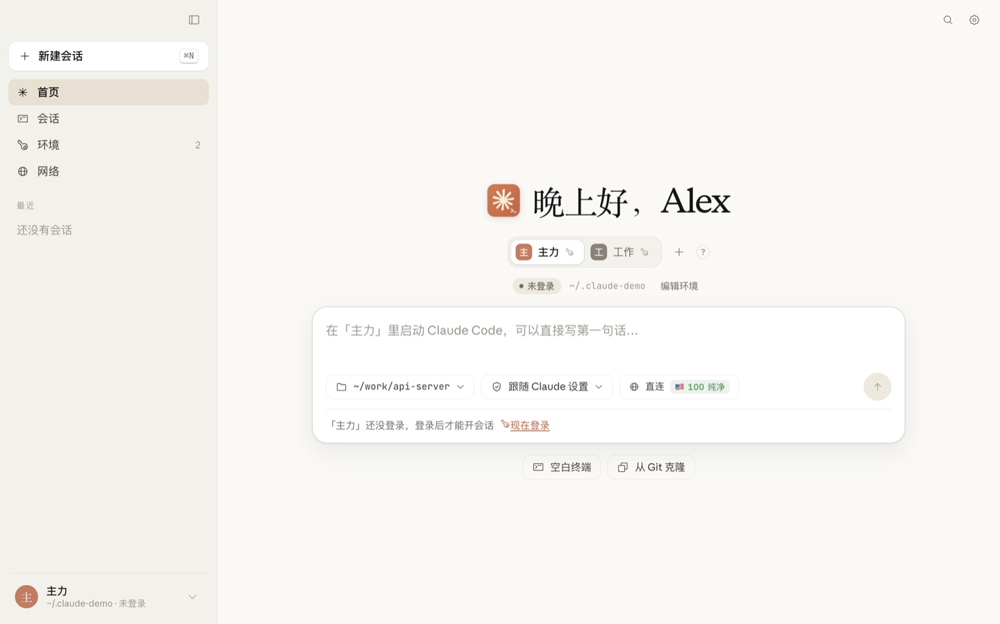
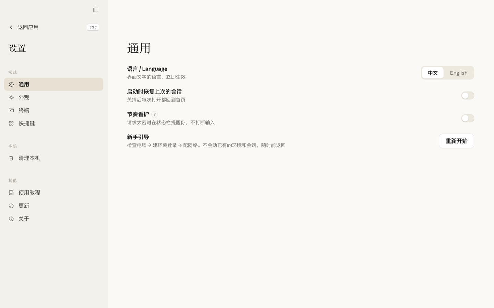

<p align="center">
  
</p>

<h1 align="center">ClaudeBuddy</h1>

<p align="center">
  给 [CC] 一个隔离、可控、不用反复配置的家
</p>

<p align="center">
  <a href="#安装"></a>
  <a href="LICENSE"></a>
  
  
  <a href="https://github.com/lmk1010/claudebuddy/releases"></a>
</p>

<p align="center">
  
</p>

---

## 它解决什么问题

同一台机器上跑多个 Claude Code 账号，事情会变得很别扭：

- 凭据在 Keychain，条目名是 `Claude Code-credentials-<配置目录哈希前8位>`，记不住哪个是哪个
- 配置目录散落在 `~/.claude*` 和 `~/.codex-config-ui/prof_*`，删号时容易漏
- 想彻底清掉一个废号，得同时处理目录、Keychain、登记文件三处
- 出了问题分不清是账号被限制、网络被拦、还是额度用完——三种处理方式完全不同

ClaudeBuddy 把这些收进一个窗口，一个账号一个环境。

## 功能

**环境隔离**

每个账号一个独立的 `CLAUDE_CONFIG_DIR`，独立的 Keychain 凭据，独立的出口代理。切换账号不用再手打环境变量，也不会因为一个号出问题把另一个号带下水。

**终端**

内嵌 xterm，直接跑 Claude Code。会话状态在侧栏一目了然——绿点是进程在跑，灰点是不在线。

**体检与清理**

打开就自动查，不需要点按钮。扫描三类配置目录，标出每个环境的状态（正常 / 掉登录 / 空壳），一键清理。目录移到回收站可捞回，Keychain 条目直接删除。

**连通归因**

请求失败时，判断是网络层、Cloudflare 挑战层、账号层还是额度层——四层的处理方式毫无交集，猜是猜不出来的。模块真发请求、按响应头与响应体判定，并明确标出哪些是推断、哪些是实测。

**节奏看护**

请求节奏可视化，避免无意识的密集调用；用量看板。

## 界面

<table>
  <tr>
    <td width="50%"></td>
    <td width="50%"></td>
  </tr>
  <tr>
    <td align="center"><sub>首页：问候、环境切换、直接开新会话</sub></td>
    <td align="center"><sub>设置：语言、外观、终端、快捷键</sub></td>
  </tr>
</table>

## 安装

**下载**

从 [Releases](https://github.com/lmk1010/claudebuddy/releases) 下载最新的 `.dmg`。

> 未做 Apple 公证，首次打开需要右键 → 打开，或到「系统设置 → 隐私与安全性」放行。

**从源码**

```bash
git clone https://github.com/lmk1010/claudebuddy.git
cd claudebuddy/app
npm install
npm run app      # 完整应用
```

`npm run dev` 是浏览器预览，没有主进程，PTY、终端、登录不可用。

**打包**

```bash
cd app
npm run dmg      # 产出 release/*.dmg
```

## 设计上的几个决定

**清理不等于删除。** 目录移到 `~/.claude-buddy-trash/`，删错了能捞回来。Keychain 条目是直接删的——那本来就是要清的东西。

**「掉了登录」不清理。** 一个 600MB、26 段对话的目录，重新登录就能接着用。按「没凭据」就删，是在毁资料。只有真正的空壳才建议清。

**不判断账号是否被封。** 那需要联网，本地看不出来。所以必须由用户自己点清理——这一点没有自动化，也不该自动化。

**诊断靠控制变量，不靠清单。** 判断「什么在挡我」，唯一可靠的办法是固定其他条件只改一项。

## 项目结构

```
app/
  electron/          主进程
    main.cjs         窗口、IPC、进程管理
    account.cjs      账号与配置目录
    cleanup.cjs      体检与清理
    diagnose.cjs     连通归因（按层判定）
    checkup.cjs      环境自检
    proxydetect.cjs  代理探测
  src/               渲染进程（React + Vite）
    components/      界面
    lib/bridge.ts    IPC 类型契约
    styles/          设计 token 与样式
docs/                实现说明与设计稿
DESIGN.md            设计系统
```

## 已知边界

- 只在 macOS ARM64 上验证过
- 未做 Apple 公证，首次打开可能需要手动放行
- 账号是否被限制不在本地判断，见上文

## 许可

MIT，见 [LICENSE](LICENSE)。
